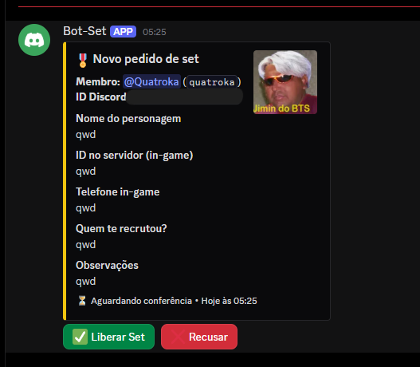
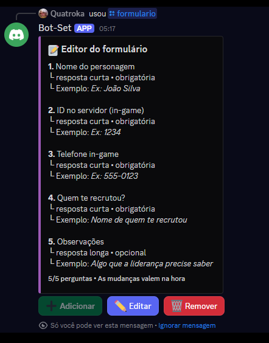

<div align="center">

# 🎖️ Bot de Pedido de Set — FiveM RP

**Sistema de registro e liberação de set para famílias de FiveM RP, feito em Discord.js v14**


</div>

---

## 📖 Sobre o projeto

Em servidores de família de FiveM RP, o pedido de set geralmente é feito de forma manual: a pessoa manda os dados no chat e a liderança copia tudo na mão. Este bot **automatiza todo o processo**:

o membro clica em um botão, preenche um formulário, a liderança confere e libera o cargo com **um clique**. Tudo com visual limpo e **sem precisar mexer no código** para mudar as perguntas.

## 🖼️ Prévia

| Painel de pedido | Análise da liderança | Editor do formulário |
|:---:|:---:|:---:|
|  |  |  |

## ✨ Funcionalidades

- 🎨 **Painel personalizável** com logo, banner e cores da família
- 📝 **Formulário em modal** (popup nativo do Discord) montado dinamicamente
- ✅ **Fluxo de aprovação**: a liderança libera o set ou recusa informando o motivo
- 🏷️ **Cargo automático** entregue ao membro quando o set é liberado
- 📩 **Notificação por DM** com o resultado do pedido
- ✏️ **Editor visual de perguntas**: o dono adiciona, edita e remove perguntas por botões, sem tocar no código
- 🔒 **Controle de permissões**: só a liderança analisa e só o dono edita o formulário
- 🛡️ **Proteções**: bloqueia pedidos duplicados, trata DM fechada, membro que saiu e canal inexistente

## 🔄 Como funciona

```
Membro clica em "Pedir Set"
        │
        ▼
Preenche o formulário (modal)
        │
        ▼
Pedido chega no canal da liderança ──► ✅ Liberar Set ──► Cargo + DM ao membro
        │
        └──────────────────────────► ❌ Recusar (com motivo) ──► DM ao membro
```

## 🛠️ Tecnologias

- [Node.js](https://nodejs.org/) 18+
- [discord.js](https://discord.js.org/) v14 (Slash Commands, Buttons, Modals, Select Menus)
- [dotenv](https://www.npmjs.com/package/dotenv) para variáveis de ambiente
- Armazenamento em arquivos JSON

## 📁 Estrutura do projeto

```
bot-familia/
├── data/                  # Dados gerados pelo bot (ignorado no Git)
├── src/
│   ├── commands/          # Slash commands (/painel, /formulario)
│   ├── events/            # Eventos do Discord (ready, interactionCreate)
│   ├── handlers/          # Lógica do registro, análise e editor
│   └── utils/             # Banco de dados JSON e embeds
├── config.js              # Personalização (nome, cores, canais, cargos)
├── deploy-commands.js     # Registro dos slash commands
└── index.js               # Ponto de entrada
```

A arquitetura separa **comandos**, **eventos** e **handlers**. Novos comandos e eventos são carregados automaticamente a partir das pastas, sem alterar o `index.js`.

## 🚀 Como executar (para avaliação)

> ⚠️ Este código é de uso restrito. Veja a seção [Licença](#-licença).

**Pré-requisitos:** Node.js 18+ e um bot criado no [Discord Developer Portal](https://discord.com/developers/applications).

```bash
# 1. Instale as dependências
npm install

# 2. Copie o arquivo de exemplo e preencha com seus dados
cp .env.example .env

# 3. Ajuste nome, cores, canais e cargos em config.js

# 4. Registre os comandos e ligue o bot
npm run deploy
npm start
```

## 🎮 Comandos

| Comando | Quem usa | Descrição |
|---|---|---|
| `/painel` | Administrador | Envia o painel de pedido de set no canal |
| `/formulario` | Dono | Abre o editor para adicionar, editar ou remover perguntas |

## 🧠 Decisões técnicas

- **Perguntas identificadas por ID**, e não por posição, evitando editar ou remover a pergunta errada.
- **Um único modal para adicionar e editar**, reaproveitando código.
- **IDs no `customId`** dos componentes (`form_edit_modal:q_123`), o que permite manter o bot sem estado em memória.
- **Configuração centralizada** em `config.js` e segredos no `.env`.
- Respeito aos limites do Discord: 5 campos por modal, 45 caracteres por título de pergunta.

## 🗺️ Próximos passos

- [ ] Log de pedidos aprovados e recusados em canal separado
- [ ] Alterar o apelido do membro para o nome do personagem
- [ ] Formulário com mais de 5 perguntas, em duas etapas
- [ ] Migração do JSON para SQLite ou MongoDB

## 📄 Licença

Copyright © 2026 SEU NOME. **Todos os direitos reservados.**

Este código está público apenas para fins de visualização e portfólio. É proibido copiar, modificar, redistribuir ou usar este software sem autorização por escrito. Veja o arquivo [LICENSE](LICENSE).

## 👤 Autor

GitHub: [@Quatrok4](https://github.com/Quatrok4)